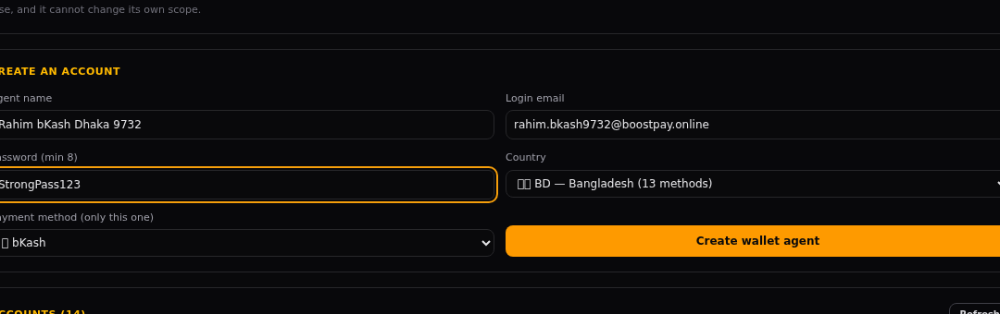
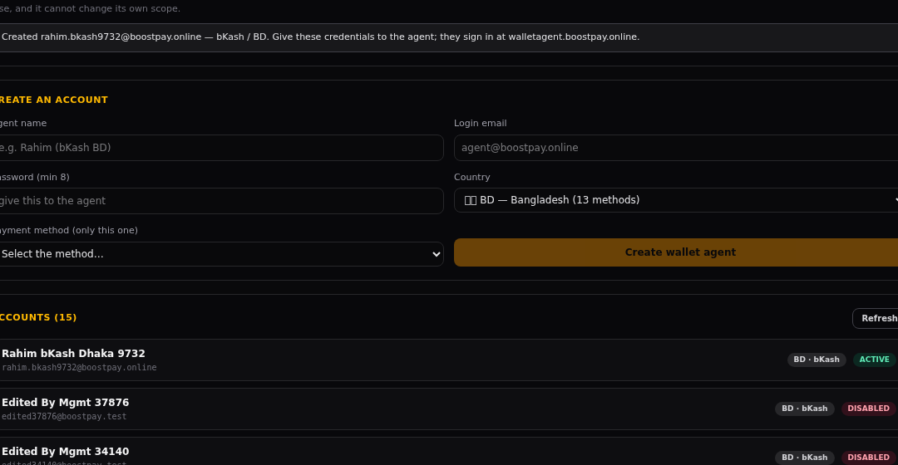

# HOW-TO — Admin panel থেকে Wallet Agent অ্যাকাউন্ট কীভাবে বানাবেন

আপডেট: 2026-11-11 · প্রযোজ্য: `walletagent.boostpay.online` প্যানেলের অ্যাজেন্ট

---

## ০. আগে একবার দেখে নিন — ২টি শর্ত

| শর্ত | কোথায় | না থাকলে |
|---|---|---|
| **১. payment method-এ দেশ সেট আছে** | `admin.boostpay.online` → **Payments** → মেথড → Countries-এ `BD` (বা যে দেশ) যোগ করা | Country ড্রপডাউনে দেশটাই আসবে না |
| **২. মেথডটি enabled** | একই স্ক্রিনে মেথড চালু | ড্রপডাউনে "Select the method…" খালি থাকবে |

একজন এজেন্ট = **১টি দেশ + ১টি পেমেন্ট মেথড**। সে শুধু ওই মেথডের deposit ও withdraw দেখবে, আর নিজে তার স্কোপ বদলাতে পারবে না।

---

## ১. ফর্ম খুলুন

`https://admin.boostpay.online` → লগইন → উপরের নেভে **Wallet Agents**



---

## ২. ৫টি ঘর ভরুন

| ঘর | কী লিখবেন | নিয়ম |
|---|---|---|
| **Agent name** | মানুষ চেনে এমন নাম, যেমন `Rahim (bKash BD)` | খালি চলবে না, সর্বোচ্চ ৮০ অক্ষর |
| **Login email** | এজেন্টের নিজের ইমেইল, যেমন `rahim.bkash@gmail.com` | ভ্যালিড ইমেইল; অন্য কোনো এজেন্ট একই ইমেইল পাবে না (দিলে `409`) |
| **Password (min 8)** | কমপক্ষে ৮ অক্ষরের শক্ত পাসওয়ার্ড | ৮-এর কম হলে সেভ হবে না |
| **Country** | কোন দেশের কাজ করবে (যেমন `🇧🇩 BD — Bangladesh`) | মেথডে ওই দেশ থাকতে হবে |
| **Payment method** | ওই দেশের কোন মেথড (যেমন `bKash`) | দেশ বাছার পরেই ড্রপডাউন খোলে |

তারপর **Create wallet agent** চাপুন।



সফল হলে সবুজ/ধূসর নোট আসবে:
> *Created rahim.bkash@gmail.com — bKash / BD. Give the agent this e-mail + password; they sign in at walletagent.boostpay.online…*

এবং **ACCOUNTS** লিস্টে নতুন কার্ড যোগ হবে — `BD · bKash`, `ACTIVE`।

---

## ৩. এজেন্টকে যা দেবেন

1. লিংক: **`https://walletagent.boostpay.online`**
2. লগইন ইমেইল (যেটা আপনি সেট করেছেন)
3. পাসওয়ার্ড (যেটা আপনি সেট করেছেন)

লগইন পেজে ইমেইল দিলে **৬ ডিজিটের কোড** সেই ইমেইলে যায় (Cloudflare One-time PIN), কোড দিয়ে ঢুকে অ্যাপের ইমেইল+পাসওয়ার্ড দিতে হবে।

---

## ৪. ⚠️ সবচেয়ে গুরুত্বপূর্ণ ধাপ — Cloudflare Access-এ ইমেইল যোগ করা

প্যানেলটি Cloudflare Access দিয়ে সুরক্ষিত। এখন allow list-এ শুধু **`mdatiqulhaquepaykassma@gmail.com`** আছে — তাই নতুন এজেন্টের ইমেইল যোগ না করলে সে **লগইন পেজই দেখতে পাবে না** (Cloudflare আটকে দেবে)।

নতুন এজেন্টের ইমেইল যোগ করার এক লাইন (আগের সব ইমেইল অটুট থাকে):

```bash
CF_HOST=walletagent.boostpay.online sh tools/cf.sh --add-email rahim.bkash@gmail.com
```

এজেন্ট চলে গেলে সরিয়ে দেবেন:

```bash
CF_HOST=walletagent.boostpay.online sh tools/cf.sh --remove-email rahim.bkash@gmail.com
```

> **সাবধান:** `--access --emails …` (বিনা `add`) **পুরো allow list রিপ্লেস করে দেয়**। একজনকে যোগ করতে হলে সবসময় `--add-email` ব্যবহার করুন।

এখন কে কে ঢুকতে পারে দেখতে:

```bash
CF_HOST=walletagent.boostpay.online sh tools/cf.sh --verify
```

**বিকল্প (আপনি চাইলে):** বাকি তিনটি প্যানেলের (admin / management / agent) মতো Access পুরো বন্ধ করে শুধু অ্যাপের নিজের ইমেইল+পাসওয়ার্ড লগইন রাখা যায় — তখন এই ধাপটি লাগবে না। বললে করে দেব।

---

## ৫. বানানোর পরে কী কী করা যায়

| কাজ | কোথায় |
|---|---|
| নাম / ইমেইল / পাসওয়ার্ড / দেশ+মেথড বদল | Admin → **Wallet Agents** → কার্ডে **Edit details** · অথবা Management → **Wallet** ট্যাব → **Edit details** |
| সাময়িক বন্ধ / চালু | Admin কার্ডে **Disable/Enable** · Management → **Disable/Enable** |
| পেন্ডিং deposit/withdraw কত | Management → Wallet কার্ডে `N dep · N wdr open` |
| ডিলিট | Admin → কার্ডে **Delete** (শুধু admin) |
| তৈরি | শুধু admin |

ইমেইল বা পাসওয়ার্ড বদলালে এজেন্টের চলতি লগইন সাথে সাথে বাতিল হয় — নতুন ক্রেডেনশিয়াল তাকে জানিয়ে দিন।

---

## ৬. সমস্যা হলে

| যা দেখছেন | কারণ | সমাধান |
|---|---|---|
| Country লিস্ট খালি | কোনো মেথডে দেশ সেট নেই | Payments → মেথড → Countries-এ দেশ যোগ করুন |
| Country বাছার পরেও মেথড খালি | ওই দেশের মেথডগুলো disabled | মেথড enable করুন |
| "A wallet agent with this email already exists" | ইমেইল আগেই ব্যবহৃত | অন্য ইমেইল দিন, বা পুরোনো অ্যাকাউন্টের ইমেইল এডিট করুন |
| "The password must be at least 8 characters" | পাসওয়ার্ড ছোট | ৮+ অক্ষর |
| "bKash is not available in …" | মেথডে ওই দেশ নেই | মেথডে দেশ যোগ করুন বা অন্য মেথড বাছুন |
| এজেন্ট বলছে "লগইন পেজ আসছে না / blocked" | Cloudflare Access allow list-এ তার ইমেইল নেই | উপরের ধাপ ৪ — `--add-email` |
| এজেন্ট লগইন করার পর queue খালি | তার মেথডে কোনো pending রিকোয়েস্ট নেই | স্বাভাবিক; অন্য মেথডের রিকোয়েস্ট সে দেখবে না |

---

## ৭. উদাহরণ — একজন bKash এজেন্ট (ঢাকা)

1. Payments-এ `bKash` মেথডে `BD` দেশ আছে ও enabled — যাচাই
2. Wallet Agents → name: `Rahim bKash Dhaka`, email: `rahim.bkash@gmail.com`, password: ৮+ অক্ষর, Country: `BD`, Method: `bKash` → **Create wallet agent**
3. `CF_HOST=walletagent.boostpay.online sh tools/cf.sh --add-email rahim.bkash@gmail.com`
4. রহিমকে লিংক + ইমেইল + পাসওয়ার্ড দিন
5. সে `https://walletagent.boostpay.online`-এ ইমেইল → ইমেইলে আসা ৬ ডিজিট কোড → পাসওয়ার্ড দিয়ে ঢুকবে এবং শুধু **bKash / BD**-এর deposit ও withdraw দেখবে
