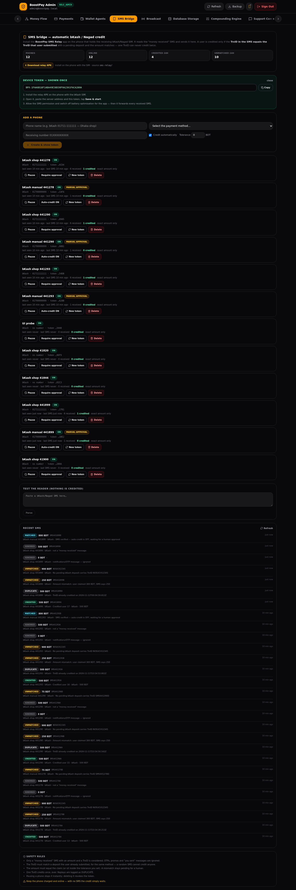

# REPORT 75 — bKash / Nagad SMS পড়ে অটোমেটিক ব্যালেন্স যোগ (SMS Relay)

তারিখ: 2026-11-11 · সার্ভার: `72.60.42.18` · নতুন অ্যাডমিন ট্যাব: **SMS Bridge**

---

## ১. আপনার চাওয়া জিনিসটা কীভাবে কাজ করে (সংক্ষেপে)

1. **আপনার (প্ল্যাটফর্মের) ফোনে** যেখানে bKash/Nagad-এর **টাকা আসে** — সেই SIM-এর ফোনে ছোট একটি অ্যাপ (`BoostPay SMS Relay`) ইনস্টল হবে।
2. ওই ফোনে **bKash/Nagad থেকে টাকা আসার SMS** এলেই অ্যাপটি SMS-টা সার্ভারে পাঠায়।
3. ইউজার অ্যাপে **অ্যাডমিন/ওয়ালেট এজেন্ট যে নম্বরটি সেট করেছে**, সেই নম্বর দেখে টাকা পাঠিয়ে **TrxID** সাবমিট করে।
4. সার্ভার দেখে: এই TrxID-এর একটি **PENDING deposit** আছে কি? মেথড মিলছে কি? **SMS-এর টাকা = ইউজার যা লিখেছে** কি? — সব মিললে deposit-টি **সাথে সাথে APPROVE** হয়ে ইউজারের ব্যালেন্সে যোগ হয়ে যায় (এবং একটা নোটিফিকেশন যায়)। মিল না হলে কিছুই যোগ হয় না — লিস্টে জমা থাকে, মানুষ দেখে সিদ্ধান্ত নেয়।

> মনে রাখবেন: এটা **ইউজারের ফোনের** অ্যাপ নয় — এটা **আপনার রিসিভিং ফোনের** অ্যাপ। ইউজারের ফোন থেকে টাকা আসে bKash-এ, আর SMS আসে আপনার ফোনে।

## ২. নিরাপত্তার নিয়ম (সার্ভারে বলবৎ, UI-তে নয়)

| নিয়ম | কেন |
|---|---|
| শুধু "টাকা পেয়েছি" টাইপ SMS; **OTP/প্রোমো/"টাকা পাঠিয়েছি" বাদ** | ভুল করে কারো ব্যালেন্স বাড়বে না |
| TrxID টি **ইউজার আগেই সাবমিট করা PENDING deposit**-এর সাথে হুবহু মিলতে হবে | অন্য কারো/পুরোনো SMS দিয়ে টাকা তোলা অসম্ভব |
| মেথড মিলতে হবে (যে ফোন bKash, সে শুধু bKash) | Nagad-এর SMS দিয়ে bKash ডিপোজিট নয় |
| **SMS-এর অ্যামাউন্ট = ইউজার যা লিখেছে** (ডিফল্টে হুবহু; চাইলে ±টলারেন্স) | ১০০ টাকা পাঠিয়ে ১০০০ টাকা দাবি করা চলবে না |
| একই TrxID **কখনোই দুইবার ক্রেডিট হয় না** (রি-প্লে = `DUPLICATE`) | ডাবল ক্রেডিট বন্ধ |
| ফোন pause করা / টোকেন বদলানো / ডিলিট করা | হারানো ফোন সাথে সাথে বন্ধ |
| টোকেন শুধু **হ্যাশ** করে রাখা, একবারই দেখানো হয় | ডেটাবেস ফাঁস হলেও টোকেন কাজ করবে না |
| প্রতিটি অটো-ক্রেডিট `SMS_AUTO_CREDIT` নামে **অডিট লগে** | কে কখন কত টাকা অটো দিল দেখা যায় |

## ৩. অ্যাডমিন কনসোল — নতুন **SMS Bridge** ট্যাব

`https://admin.boostpay.online` → **SMS Bridge**

- **Add a phone:** নাম + পেমেন্ট মেথড + রিসিভিং নম্বর (`01XXXXXXXXX`) → **Create & show token** → `BPX-…` টোকেন দেখায় (**একবারই**)
- প্রতিটি ফোনের কার্ড: ON/PAUSED, মেথড, নম্বর, শেষবার কখন SMS এসেছে, কত SMS প্রসেস হয়েছে, **কত ডিপোজিট ক্রেডিট হয়েছে**
- বোতাম: **Pause/Resume** · **Require approval** (অটো-ক্রেডিট বন্ধ করে শুধু SMS যাচাই) · **New token** · **Delete**
- **⬇ Download relay APK** — সাইট থেকেই নামানো যায়
- **Test the reader:** যেকোনো SMS পেস্ট করে দেখুন সার্ভার কী পড়ছে (কিছুই ক্রেডিট হয় না)
- **Recent SMS** লিস্ট: `CREDITED / MATCHED / UNMATCHED / AMOUNT_MISMATCH / DUPLICATE / IGNORED` — প্রতিটার কারণ লেখা থাকে

## ৪. ফোনে অ্যাপ ইনস্টল (৫ মিনিট)

1. `https://boostpay.online/download/boostpay-sms-relay.apk` থেকে APK নামান (অথবা GitHub Actions → **SMS Relay APK** → artifact)
2. ফোনে ইনস্টল (Unknown sources / "Install anyway" অন করুন)
3. খুলুন → **Server address** (আগে থেকেই `https://boostpay.online`) + **Device token** (অ্যাডমিন কনসোল থেকে কপি) → **Save & start forwarding**
4. SMS পারমিশন **Allow** দিন
5. **Allow background (battery)** চেপে "Unrestricted" করুন (নাহলে Xiaomi/Oppo/Vivo SMS দেরি করে দেয়)
6. **Send a test message now** — স্ক্রিনে `test result: IGNORED` দেখালেই সার্ভারের সাথে যোগাযোগ ঠিক আছে

অ্যাপের ফিচার: ফোন বুট হলেও কাজ করে · ইন্টারনেট না থাকলে SMS হারায় না (পরেরবার পাঠানো হয় না, কিন্তু সার্ভার রিকোয়েস্ট সবসময় ইন্টারনেট-নির্ভর) · স্ক্রিনে কত SMS গেছে ও কত ডিপোজিট ক্রেডিট হয়েছে দেখা যায় · APK সাইজ মাত্র ~১৯ KB।

## ৫. ইউজারের অভিজ্ঞতা (কিছুই বদলায়নি)

আগের মতোই: ইউজার **Deposit** → মেথড বাছেন → **যে নম্বর দেখানো হয় সেখানে টাকা পাঠান** → **TrxID লিখে Submit**।
পার্থক্য শুধু: **১৫ মিনিট / কয়েক ঘণ্টা অপেক্ষা নেই — SMS আসার সাথে সাথেই ব্যালেন্স যোগ** (সাধারণত কয়েক সেকেন্ড)।

## ৬. যেসব পরিস্থিতিতে অটো হবে না (ইচ্ছাকৃত)

| অবস্থা | ফল |
|---|---|
| TrxID ভুল/ভুয়া লিখেছে | `UNMATCHED` — কিছুই যোগ হবে না |
| টাকা পাঠিয়েছে ৫০০, লিখেছে ৬০০ | `AMOUNT_MISMATCH` — pending থাকে, মানুষ দেখবে |
| একই TrxID আবার | `DUPLICATE` — দ্বিতীয়বার যোগ হবে না |
| SMS আসেনি (ফোন বন্ধ/ইন্টারনেট নেই) | pending থাকে — পরে SMS এলে নিজেই যোগ হবে |
| ফোনটি pause করা | কিছুই হবে না |
| Nagad-এর SMS, কিন্তু ইউজার bKash ডিপোজিট | কিছুই হবে না (মেথড আলাদা) |

## ৭. টেস্ট (সব সবুজ)

| টেস্ট | ফল |
|---|---|
| `tools/sms-check.py` — API: তৈরি, হ্যাশ, অটো-ক্রেডিট, ডাবল-ক্রেডিট ব্লক, ভুল অ্যামাউন্ট, ভুল TrxID, OTP, "sent" SMS, ভুল/বন্ধ টোকেন, pause, manual-approval মোড, বাংলা SMS পার্স | **28 pass / 0 fail** |
| `tools/sms-admin-ui-check.py` — আসল ব্রাউজারে SMS Bridge ট্যাব, টোকেন, pause/resume, পার্সার | **9 pass / 0 fail** |
| `tools/payments-check.py` (রিগ্রেশন) | **No problems found** |

## ৮. প্রযুক্তি (কে কী করে)

| অংশ | ফাইল |
|---|---|
| SMS পার্সার (বাংলা+ইংরেজি, ৳/Tk/টাকা, Binance-স্টাইল TrxID) | `sms-parse.ts` |
| ডিভাইস রেজিস্ট্রি, `/api/sms/ingest`, অটো-ম্যাচ ও অডিট | `server.ts` (SMS BRIDGE সেকশন) |
| অ্যাডমিন UI | `admin-app/src/components/SmsBridgeAdmin.tsx` |
| Android অ্যাপ (native, কোনো লাইব্রেরি নেই) | `sms-relay/` → `SmsReceiver.java`, `Relay.java`, `MainActivity.java` |
| APK ডাউনলোড রুট | `GET /download/boostpay-sms-relay.apk` |
| GitHub Actions বিল্ড | `.github/workflows/sms-relay-apk.yml` |

## ৯. যা এখনো করা লাগবে (শুধু আপনি করতে পারবেন)

1. **রিসিভিং নম্বর ঠিক করা** — কোন bKash/Nagad নম্বরগুলোতে ইউজারেরা টাকা পাঠাবে; ওই নম্বরগুলো Payments → মেথডের "Account number"-এ বসানো আছে কি না দেখুন (ইউজার এই নম্বরটাই দেখে)
2. **ফোনটি ঠিক করা** — ২৪/৭ চালু, চার্জে, ইন্টারনেটসহ; সিমে SMS-এর জন্য পর্যাপ্ত টাকা/প্যাকেজ
3. **প্রথমবার:** SMS Bridge → Add a phone → টোকেন → ফোনে ইনস্টল → Save & start → test message

> ⚠️ **গুরুত্বপূর্ণ:** Google Play নীতিতে এই ধরনের (সব SMS পড়া) অ্যাপ Play Store-এ রাখা যায় না — তাই এটি **আমাদের নিজের সাইট থেকে সরাসরি ইনস্টল (sideload)**। ফোনে "Unknown sources" অন করতে হবে। এটা কোনো নিষিদ্ধ কাজ নয় — এটা আপনার নিজের ব্যবসার নিজের ফোন, নিজের SIM।
